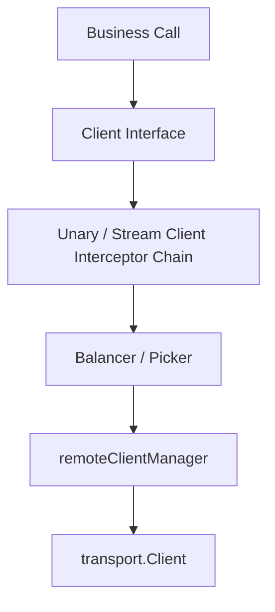

# 06. 传输、服务发现与可观测性


> 本文说明 Yggdrasil v3 的协议无关传输模型、REST Gateway、安全 Profile、注册发现、负载均衡、拦截器、中间件和可观测性集成。
>
> 关键词：App、Hub、Module、Capability、assembly.Spec、prepared runtime assembly、Prepare、Compose、BusinessBundle、Staged Reload。


## 1. 协议无关传输模型

Yggdrasil 通过 transport provider 解耦 RPC 框架与具体网络协议。服务端和客户端 transport 都作为 capability 注册，由装配计划和 Hub 选择。

```go
type TransportServerProvider interface {
    Protocol() string
    NewServer(handle MethodHandle) (Server, error)
}

type TransportClientProvider interface {
    Protocol() string
    NewClient(
        ctx context.Context,
        serviceName string,
        endpoint resolver.Endpoint,
        statsHandler stats.Handler,
        onStateChange OnStateChange,
    ) (Client, error)
}
```

Hub 只持有 provider；具体 server/client 实例由对应 runtime 子系统创建和管理。

## 2. Server / Client 抽象

### 2.1 Server

```go
type Server interface {
    Start() error
    Handle() error
    Stop(context.Context) error
    Info() ServerInfo
}
```

- `Start`：绑定并开始监听；
- `Handle`：阻塞处理请求，通常由 errgroup 调用；
- `Stop`：优雅关闭；
- `Info`：返回协议、地址和属性。

### 2.2 Client

```go
type Client interface {
    NewStream(ctx context.Context, desc *stream.Desc, method string) (stream.ClientStream, error)
    Close() error
    Protocol() string
    State() State
    Connect()
}
```

连接状态：`Idle -> Connecting -> Ready -> TransientFailure -> Shutdown`。

### 2.3 gRPC 线协议兼容

内置 `grpc` transport 使用 grpc-go 提供 HTTP/2 和 gRPC 线协议。这里的兼容是
指标准 grpc-go client 可以调用 Yggdrasil RPC service，Yggdrasil client 也可以
调用标准 grpc-go server；不表示 grpc-go 的生成代码、`ServiceDesc`、
`CallOption` 或源码级 interceptor 可以直接替换为 Yggdrasil API。

| 行为 | grpc-go client 到 Yggdrasil server | Yggdrasil client 到 grpc-go server |
| --- | --- | --- |
| Unary、客户端流、服务端流、双向流 | 支持 | 支持 |
| Protobuf payload 与 gzip 压缩 | 支持 | 支持 |
| 普通、多值、`-bin` metadata | 支持 | 支持 |
| 响应 header 与 trailer | 支持 | 支持 |
| gRPC status code、message、`ErrorInfo` details | 支持 | 支持 |
| Trailers-only error | 支持 | 支持 |
| TLS 与 mTLS | 支持 | 支持 |
| Deadline、取消与 peer 信息 | 支持 | 支持 |
| 标准 health 与 reflection service | Yggdrasil server 支持 | 不承诺 |

Authority、user-agent、gRPC 保留 header 和二进制 metadata 的语义交给 grpc-go
处理。Yggdrasil 只进行无损类型转换，不改变 metadata 的基数或字节。`raw` 和
`jsonraw` 仍是 Yggdrasil 自有 codec，不属于跨语言兼容承诺。

health 默认开启，reflection 默认关闭，需要显式启用：

```yaml
yggdrasil:
  transports:
    grpc:
      server:
        address: ":9090"
        health_enabled: true
        reflection_enabled: true
```

`health_enabled: false` 表示关闭 health service；`nil` 表示默认值 `true`。
health 服务在 `Serve` 前返回 `NOT_SERVING`；进入 `Serve` 后，总体服务、已注册的
Yggdrasil RPC service、health 以及已启用的 reflection service 返回
`SERVING`。Stop 时这些状态切回 `NOT_SERVING`。health 与 reflection 属于
transport 配置，变更后需要重启。

只要 health 或 reflection 启用，`code_proto` 必须为 `proto`。强制使用非 proto
server codec 会导致标准 health/reflection 请求无法解码，因此启动阶段直接返回
配置错误。选择自定义 server codec 前应同时关闭这两个标准服务。

启用 reflection 后，可以使用标准工具发现和探测服务：

```sh
grpcurl -plaintext localhost:9090 list
grpcurl -plaintext localhost:9090 describe grpc.testing.TestService
grpcurl -plaintext -d '{"service":""}' localhost:9090 grpc.health.v1.Health/Check
grpcurl -plaintext -d '{"service":""}' localhost:9090 grpc.health.v1.Health/Watch
grpc_health_probe -addr=localhost:9090
```

Yggdrasil unary 调用需要在发起调用前建立响应 metadata 捕获上下文：

```go
ctx := metadata.WithStreamContext(
    metadata.WithOutContext(context.Background(), metadata.Pairs("trace-id", "abc")),
)
resp, err := client.SayHello(ctx, request)

header, _ := metadata.FromHeaderCtx(ctx)
trailer, _ := metadata.FromTrailerCtx(ctx)
```

Yggdrasil streaming 调用使用生成代码提供的 stream 方法。`Header` 获取响应
header；`Trailer` 必须在终止 `Recv` 或 `CloseAndRecv` 之后读取：

```go
stream, err := client.SayHelloServerStream(ctx, request)
header, err := stream.Header()
for {
    resp, err := stream.Recv()
    if err == io.EOF {
        break
    }
    // handle resp
}
trailer := stream.Trailer()
```

Yggdrasil 不暴露 grpc-go 原生 resolver、balancer、xDS、service config
retry/hedging、call credentials 或源码级 interceptor API。应使用 Yggdrasil 的
resolver、balancer、security profile 和 interceptor 配置。客户端 health-aware
balancing 也不在本兼容契约内。

## 3. REST Gateway 与 Raw HTTP

业务可以同时注册：

- RPC service desc；
- REST service desc；
- Raw HTTP handler。

REST 与 Raw HTTP 的 route 冲突必须在安装阶段检查，冲突维度通常是 method + path。

REST RPC handler 必须返回非 nil 的 `proto.Message`；nil 或类型不匹配会返回
Internal error，而不是执行 unchecked assertion。HTTP client stream 的 `Header`
与 `RecvMsg` 共用同一条 response 路径：发送前调用 `Header` 返回
`FAILED_PRECONDITION`，等待 response 时会响应 context 取消。非 200 response
body 无法解码为 RPC status 时，客户端只返回 HTTP 状态码和通用消息，不返回原始
response body。

REST peer metadata 只有在 socket 对端命中 `trusted_proxy_cidrs` 时才信任
`X-Forwarded-For` 与 `X-Real-IP`。该配置默认为空，表示完全忽略转发头；部署时必须
显式列出代理 hop，并沿转发链从右向左选择第一个非可信地址。

## 4. 安全 Profile

安全系统采用 Provider -> Profile -> Material 管线：

```go
type Provider interface {
    Type() string
    Compile(name string, raw map[string]any) (Profile, error)
}

type Profile interface {
    Name() string
    Type() string
    Build(spec BuildSpec) (Material, error)
}
```

`Material` 包含 TLS 配置、请求认证器和连接认证器：

```go
type Material struct {
    Mode        Mode
    ClientTLS   *tls.Config
    ServerTLS   *tls.Config
    RequestAuth RequestAuthenticator
    ConnAuth    ConnAuthenticator
}
```

安全模式：

| Mode | 描述 |
|---|---|
| `insecure` | 无加密与认证 |
| `local` | 本地安全策略 |
| `tls` | TLS / 可选 mTLS |

## 5. 服务注册 Registry

```go
type Registry interface {
    Register(context.Context, Instance) error
    Deregister(context.Context, Instance) error
    Type() string
}
```

应用启动后注册实例，优雅关闭时注销实例。`multi_registry` 可以把注册/注销 fan-out 到多个后端，并支持 fail-fast 策略。

## 6. 服务发现 Resolver

```go
type Resolver interface {
    AddWatch(serviceName string, client Client) error
    DelWatch(serviceName string, client Client) error
    Type() string
}
```

Resolver 观察服务 endpoint 变化，并通过 client callback 更新状态。resolver watch 是动态对象，不注册到 Hub。

## 7. 负载均衡 Balancer / Picker

```go
type Balancer interface {
    UpdateState(resolver.State)
    Close() error
    Type() string
}

type Picker interface {
    Next(RPCInfo) (PickResult, error)
}
```

内置 round-robin 使用 atomic counter 选择下一个可用 endpoint。Balancer 运行时状态属于 client 子系统，不进入 Hub。

## 8. RPC 客户端调用链



Hub 只提供 resolver provider、balancer provider、transport client provider、credentials provider、client interceptor provider。

## 9. 拦截器与 Middleware

链式扩展点由三部分组成：

1. 模块提供具名 provider；
2. 配置给出最终有序名称列表或模板；
3. 子系统按顺序解析并组链。

执行顺序只来自配置，不来自模块注册顺序、DAG、`InitOrder()` 或 map 遍历。

```go
ints, err := module.ResolveOrdered[interceptor.UnaryServerInterceptorProvider](
    hub,
    capabilities.UnaryServerInterceptorSpec,
    resolved.OrderedExtensions.UnaryServer,
)
```

## 10. 可观测性

### 10.1 Logger

日志系统拆为 handler builder、writer builder 和 logger core。内置 logger handler / writer capability 是 `NamedOne`；runtime 通过显式 capability binding 解析配置中的名称，不能取第一个。

### 10.2 Tracer / Meter

TracerProvider 与 MeterProvider builder 是 `NamedOne` capability，分别由 `yggdrasil.observability.telemetry.tracer` 和 `yggdrasil.observability.telemetry.meter` 选择。存在多个可用 provider 是合法的；选择了不存在的 provider 才会在规划或 runtime prepare 阶段失败。

### 10.3 Stats Handler

Stats handler builder 是 `NamedOne` capability。server/client runtime 根据 telemetry stats 配置构建各自的 handler chain。

### 10.4 Diagnostics

Governor 应暴露：

- 拓扑序和拓扑层级；
- capability 冲突；
- reload state；
- restart-required；
- plan hash 与 spec diff；
- transport server info；
- registry / resolver / balancer 状态摘要。

governor 监听地址由 `yggdrasil.admin.governor.bind` 决定。`bind` 未配置时使用 loopback。非回环地址和通配地址必须配置 `governor.auth.token` 或 basic authentication，否则启动失败。`/configs` 始终返回脱敏副本：敏感键名、URL 中的密码以及 `governor.redact_paths` 指定的路径都会替换为 `[REDACTED]`。`yggdrasil.admin.governor.host` 是 `bind` 的弃用别名，优先级更低。

RPC 和 REST listener 保留用户配置的 bind 地址。bind host 为空或通配时，框架保留实际监听端口，只把发布到 registry 的 host 换成本机主路由 IPv4。需要发布固定 host、端口、代理或 NAT 地址时，应设置 transport 的 `advertise_address`。

## 11. 自定义 Transport 模块示例

```go
type MyTransportModule struct{}

func (m *MyTransportModule) Name() string { return "transport.my_protocol" }

func (m *MyTransportModule) Capabilities() []module.Capability {
    return []module.Capability{
        {
            Spec: capabilities.TransportServerProviderSpec, // NamedOne
            Name: "my_protocol",
            Value: transport.NewTransportServerProvider(
                "my_protocol",
                func(handle transport.MethodHandle) (transport.Server, error) {
                    return newMyServer(handle), nil
                },
            ),
        },
        {
            Spec: capabilities.TransportClientProviderSpec, // NamedOne
            Name: "my_protocol",
            Value: transport.NewTransportClientProvider(
                "my_protocol",
                func(ctx context.Context, service string, endpoint resolver.Endpoint, stats stats.Handler, onChange transport.OnStateChange) (transport.Client, error) {
                    return newMyClient(ctx, service, endpoint), nil
                },
            ),
        },
    }
}
```

配置：

```yaml
yggdrasil:
  server:
    transports:
      - "my_protocol"
  transports:
    my_protocol:
      server:
        address: ":9090"
```
